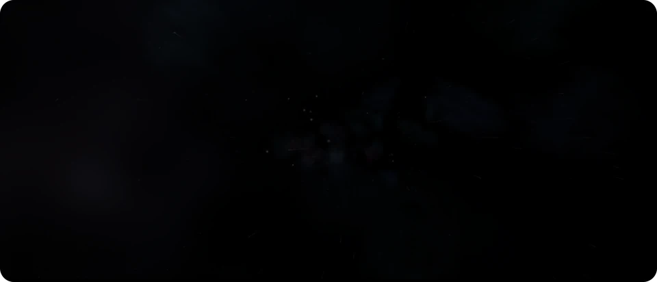
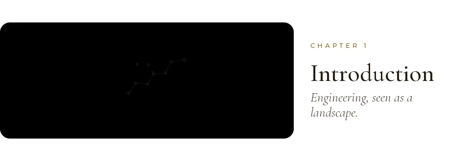
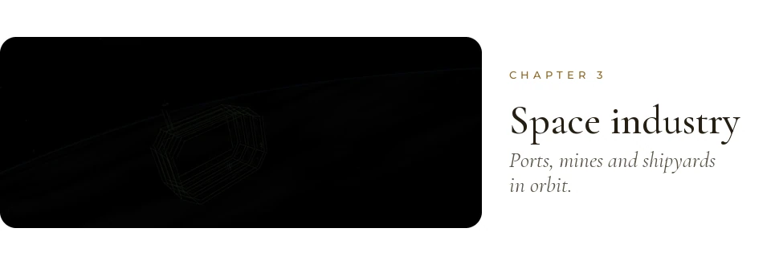
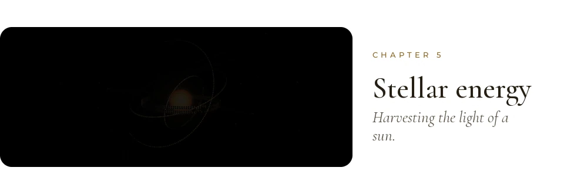
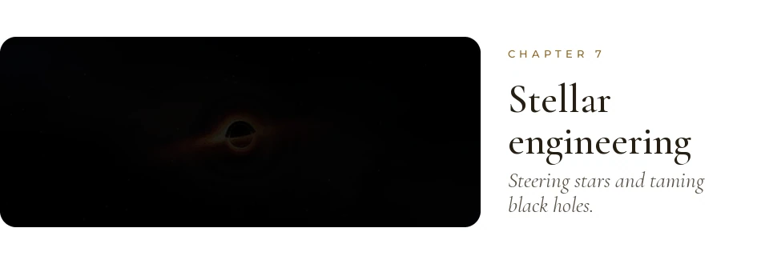
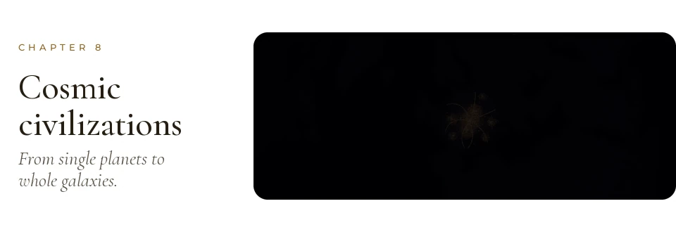
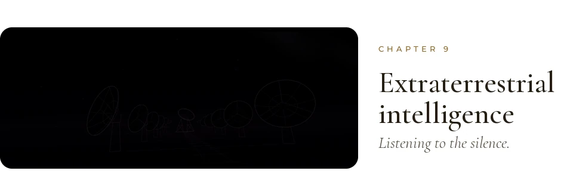

<p align="center">
  <a href="https://drayzu.github.io/AstroIngenieria/"><picture><source media="(prefers-color-scheme: dark)" srcset="docs/readme/clips/hero-v5-dark.webp"></picture></a>
</p>

<p align="center">
  <a href="https://drayzu.github.io/AstroIngenieria/"><picture><source media="(prefers-color-scheme: dark)" srcset="docs/readme/address-dark.svg"></picture></a>
</p>

<p align="center">
  <picture><source media="(prefers-color-scheme: dark)" srcset="docs/readme/clips/intro-v3-dark.webp"></picture>
</p>

<p align="center">
  <picture><source media="(prefers-color-scheme: dark)" srcset="docs/readme/clips/habitats-v3-dark.webp"></picture>
</p>

<p align="center">
  <picture><source media="(prefers-color-scheme: dark)" srcset="docs/readme/clips/industry-v3-dark.webp"></picture>
</p>

<p align="center">
  <picture><source media="(prefers-color-scheme: dark)" srcset="docs/readme/clips/planetary-v3-dark.webp"></picture>
</p>

<p align="center">
  <picture><source media="(prefers-color-scheme: dark)" srcset="docs/readme/clips/energy-v3-dark.webp"></picture>
</p>

<p align="center">
  <picture><source media="(prefers-color-scheme: dark)" srcset="docs/readme/clips/travel-v3-dark.webp"></picture>
</p>

<p align="center">
  <picture><source media="(prefers-color-scheme: dark)" srcset="docs/readme/clips/stellar-v3-dark.webp"></picture>
</p>

<p align="center">
  <picture><source media="(prefers-color-scheme: dark)" srcset="docs/readme/clips/civilizations-v3-dark.webp"></picture>
</p>

<p align="center">
  <picture><source media="(prefers-color-scheme: dark)" srcset="docs/readme/clips/search-v3-dark.webp"></picture>
</p>

<p align="center">
  <a href="https://drayzu.github.io/AstroIngenieria/"><picture><source media="(prefers-color-scheme: dark)" srcset="docs/readme/header-prologue-dark.svg"></picture></a>
</p>

<p align="center">
  <a href="https://drayzu.github.io/AstroIngenieria/"><picture><source media="(prefers-color-scheme: dark)" srcset="docs/readme/enter-v2-dark.svg"></picture></a>
</p>

<br>

<details>
<summary><sub>Under the hood</sub></summary>
<br>

- A museum you fly through: 106 illustrated readings on how we could build in space, across nine chapters.
- Scroll to travel; each chapter opens through its own portal. Press <kbd>C</kbd> (or add `?cine`) and the museum tours itself.
- React + TypeScript + Vite, deployed to GitHub Pages. The sky, portals and chapter worlds are Three.js, hand-written shaders and Canvas 2D (some drawn in a worker), with illustrations brought to life through depth maps.
- Content is in Spanish.

```bash
npm install
npm run dev     # local museum
npm run build   # production bundle in dist/
```

</details>
