<p align="center">
  <a href="https://drayzu.github.io/AstroIngenieria/">
    
  </a>
</p>

<p align="center">
  <a href="https://drayzu.github.io/AstroIngenieria/">
    
  </a>
</p>

<p align="center">
  <a href="https://drayzu.github.io/AstroIngenieria/">
    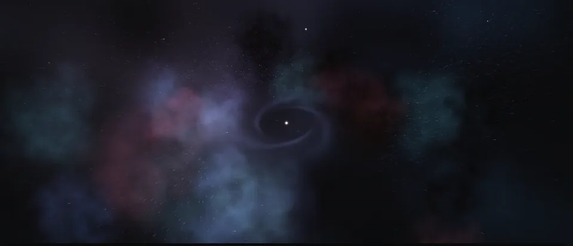
  </a>
</p>

<p align="center"><em>A museum you fly through: 106 illustrated readings on how we could build in space, from orbital homes to engines that move stars, across nine chapters.</em></p>

<table align="center">
  <tr>
    <td align="center">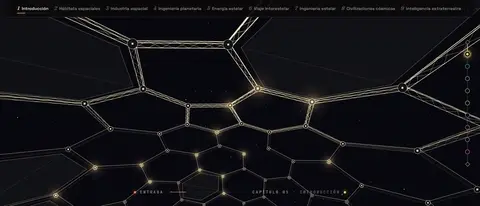<br/><sub><b>01 · Introduction</b> — engineering as landscape</sub></td>
    <td align="center">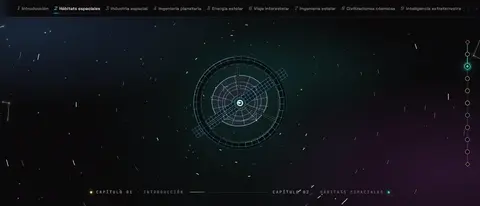<br/><sub><b>02 · Space habitats</b> — homes that spin</sub></td>
    <td align="center">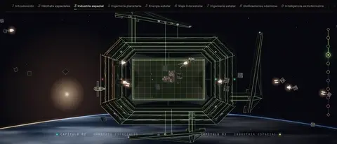<br/><sub><b>03 · Space industry</b> — ports, mines, shipyards</sub></td>
  </tr>
  <tr>
    <td align="center">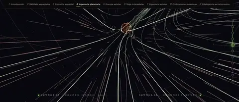<br/><sub><b>04 · Planetary engineering</b> — a field to shield a world</sub></td>
    <td align="center">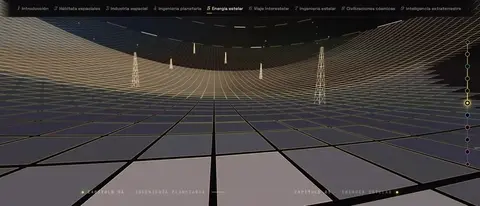<br/><sub><b>05 · Stellar energy</b> — harvesting a sun</sub></td>
    <td align="center">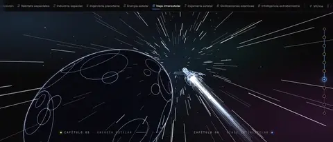<br/><sub><b>06 · Interstellar travel</b> — the long way out</sub></td>
  </tr>
  <tr>
    <td align="center">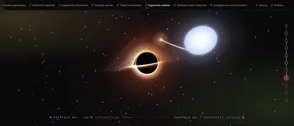<br/><sub><b>07 · Stellar engineering</b> — steering stars, taming black holes</sub></td>
    <td align="center">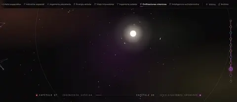<br/><sub><b>08 · Cosmic civilizations</b> — from planets to galaxies</sub></td>
    <td align="center">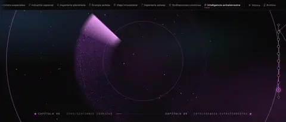<br/><sub><b>09 · Extraterrestrial intelligence</b> — listening to the silence</sub></td>
  </tr>
</table>

<p align="center"><sub>Scroll to travel · each chapter opens through its own portal · press <kbd>C</kbd> (or add <code>?cine</code>) and the museum tours itself</sub></p>

<details>
<summary><sub>Under the hood</sub></summary>

<br/>

React + TypeScript + Vite, deployed to GitHub Pages. The sky, portals and chapter worlds are Three.js, hand-written shaders and Canvas 2D (some drawn in a worker), with illustrations brought to life through depth maps. Content is in Spanish.

```bash
npm install
npm run dev     # local museum
npm run build   # production bundle in dist/
```

</details>
