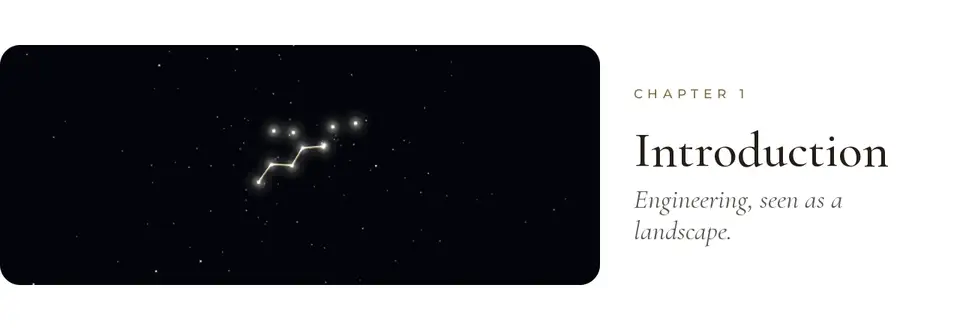
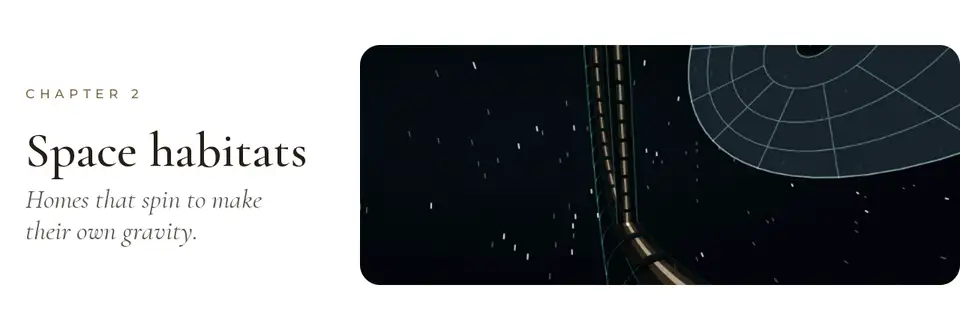
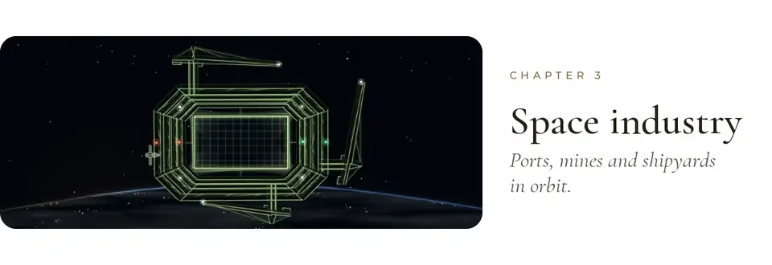
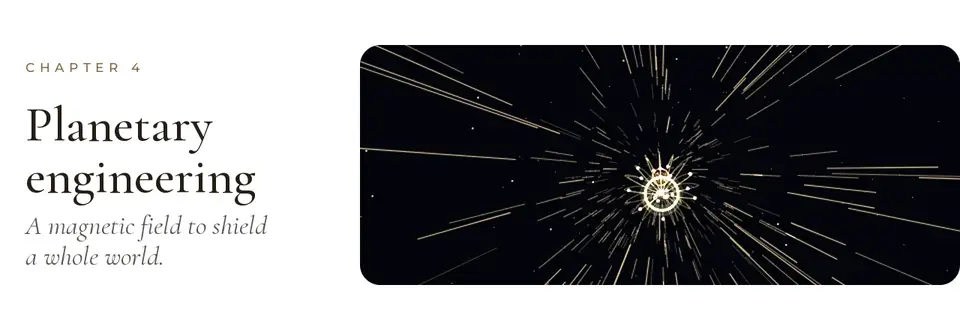
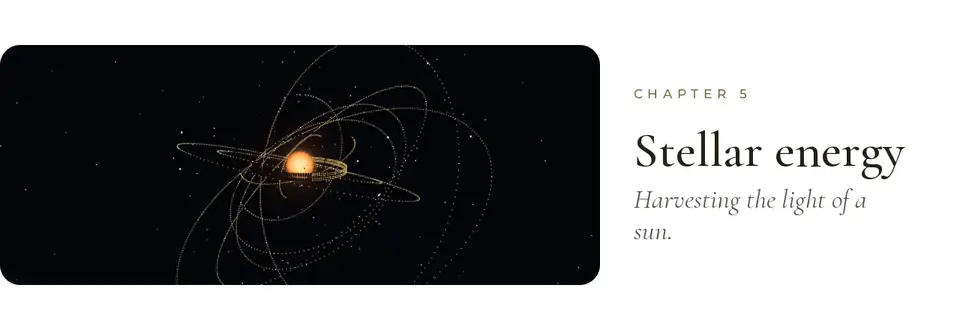
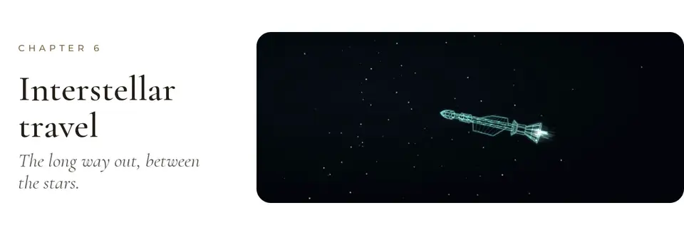
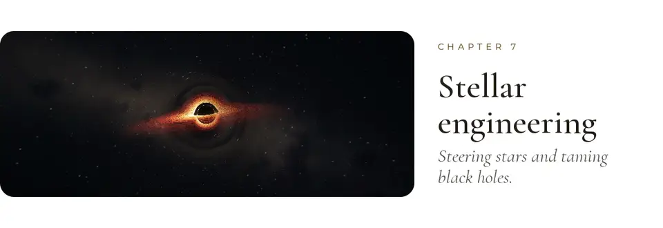
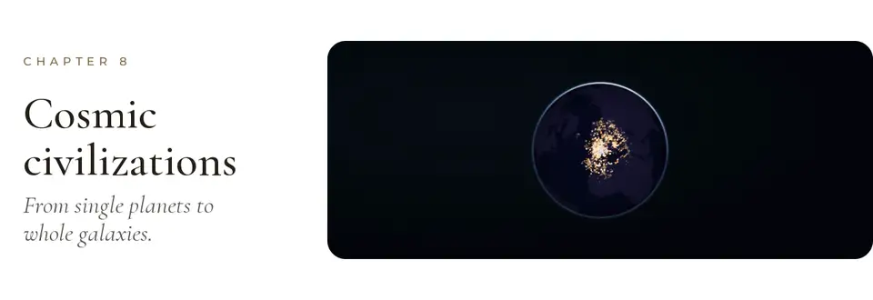
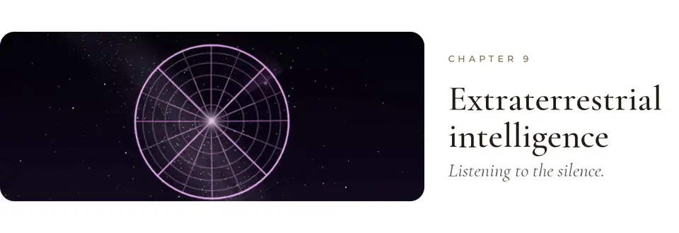

<p align="center">
  <a href="https://drayzu.github.io/Atlas/"><picture><source media="(prefers-color-scheme: dark)" type="image/avif" srcset="docs/readme/clips/hero-v8-dark.avif"><source media="(prefers-color-scheme: dark)" srcset="docs/readme/clips/hero-v8-dark.webp"><source type="image/avif" srcset="docs/readme/clips/hero-v8-light.avif"></picture></a>
</p>

<p align="center">
  <picture><source media="(prefers-color-scheme: dark)" type="image/avif" srcset="docs/readme/clips/intro-v5-dark.avif"><source media="(prefers-color-scheme: dark)" srcset="docs/readme/clips/intro-v5-dark.webp"><source type="image/avif" srcset="docs/readme/clips/intro-v5-light.avif"></picture>
</p>

<p align="center">
  <picture><source media="(prefers-color-scheme: dark)" type="image/avif" srcset="docs/readme/clips/habitats-v5-dark.avif"><source media="(prefers-color-scheme: dark)" srcset="docs/readme/clips/habitats-v5-dark.webp"><source type="image/avif" srcset="docs/readme/clips/habitats-v5-light.avif"></picture>
</p>

<p align="center">
  <picture><source media="(prefers-color-scheme: dark)" type="image/avif" srcset="docs/readme/clips/industry-v5-dark.avif"><source media="(prefers-color-scheme: dark)" srcset="docs/readme/clips/industry-v5-dark.webp"><source type="image/avif" srcset="docs/readme/clips/industry-v5-light.avif"></picture>
</p>

<p align="center">
  <picture><source media="(prefers-color-scheme: dark)" type="image/avif" srcset="docs/readme/clips/planetary-v5-dark.avif"><source media="(prefers-color-scheme: dark)" srcset="docs/readme/clips/planetary-v5-dark.webp"><source type="image/avif" srcset="docs/readme/clips/planetary-v5-light.avif"></picture>
</p>

<p align="center">
  <picture><source media="(prefers-color-scheme: dark)" type="image/avif" srcset="docs/readme/clips/energy-v5-dark.avif"><source media="(prefers-color-scheme: dark)" srcset="docs/readme/clips/energy-v5-dark.webp"><source type="image/avif" srcset="docs/readme/clips/energy-v5-light.avif"></picture>
</p>

<p align="center">
  <picture><source media="(prefers-color-scheme: dark)" type="image/avif" srcset="docs/readme/clips/travel-v5-dark.avif"><source media="(prefers-color-scheme: dark)" srcset="docs/readme/clips/travel-v5-dark.webp"><source type="image/avif" srcset="docs/readme/clips/travel-v5-light.avif"></picture>
</p>

<p align="center">
  <picture><source media="(prefers-color-scheme: dark)" type="image/avif" srcset="docs/readme/clips/stellar-v5-dark.avif"><source media="(prefers-color-scheme: dark)" srcset="docs/readme/clips/stellar-v5-dark.webp"><source type="image/avif" srcset="docs/readme/clips/stellar-v5-light.avif"></picture>
</p>

<p align="center">
  <picture><source media="(prefers-color-scheme: dark)" type="image/avif" srcset="docs/readme/clips/civilizations-v5-dark.avif"><source media="(prefers-color-scheme: dark)" srcset="docs/readme/clips/civilizations-v5-dark.webp"><source type="image/avif" srcset="docs/readme/clips/civilizations-v5-light.avif"></picture>
</p>

<p align="center">
  <picture><source media="(prefers-color-scheme: dark)" type="image/avif" srcset="docs/readme/clips/search-v5-dark.avif"><source media="(prefers-color-scheme: dark)" srcset="docs/readme/clips/search-v5-dark.webp"><source type="image/avif" srcset="docs/readme/clips/search-v5-light.avif"></picture>
</p>

<p align="center">
  <a href="https://drayzu.github.io/Atlas/"><picture><source media="(prefers-color-scheme: dark)" srcset="docs/readme/address-dark.svg"></picture></a>
</p>

<br>

<details>
<summary><sub>Under the hood</sub></summary>
<br>

- **What it is.** A museum you fly through: 106 illustrated readings on how we could build in space, from orbital homes to Dyson swarms and engines that move stars, across nine chapters. In Spanish, with an English version.
- **How to visit.** Scroll to travel; each chapter opens through its own portal, and the star map in the side rail is the index. Press <kbd>C</kbd> (or add `?cine`) and the museum tours itself.
- **How it's built.** React + TypeScript + Vite on GitHub Pages. The sky, portals and chapter worlds are Three.js and hand-written shaders (the chapter 7 black hole is ray-traced on the GPU), with Canvas 2D, some of it drawn in a worker, and illustrations brought to life through depth maps.

```bash
npm install
npm run dev     # local museum
npm run build   # production bundle in dist/
```

</details>
